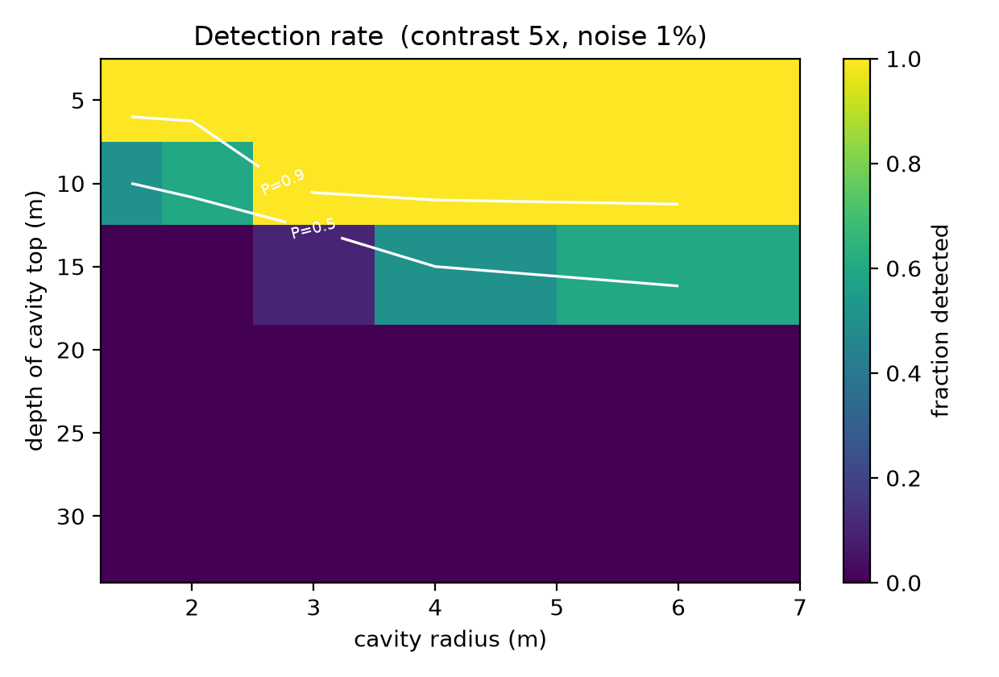
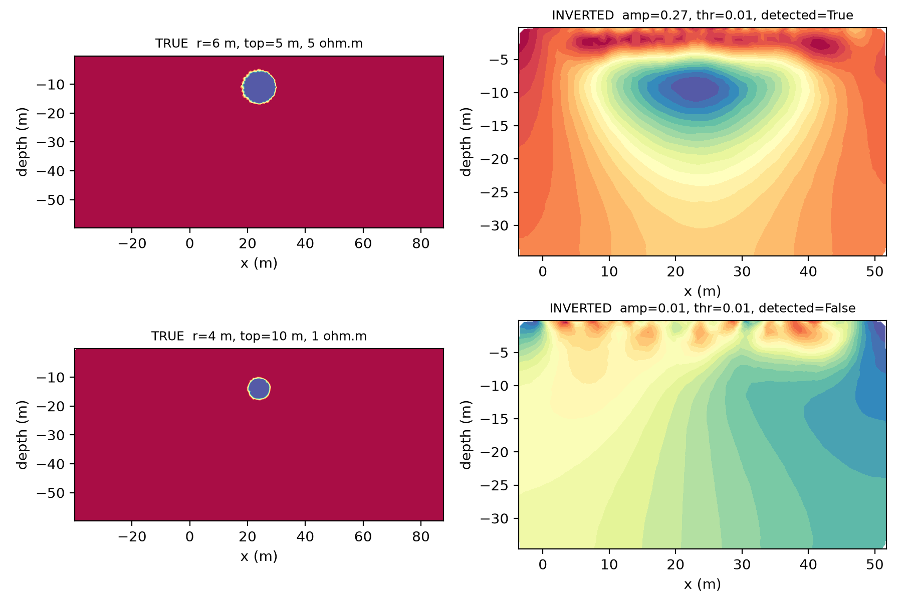

# Detectability of water-filled voids with surface ERT

A synthetic benchmark that quantifies **how deep** surface electrical resistivity
tomography (ERT) can detect a water-filled cavity in mine workings — and **what a
missed detection looks like** in the inverted image.



## Key result

| Depth of cavity top | Detection probability |
|---|---|
| ≤ 10 m | ≥ 0.9 |
| 12–16 m | ≈ 0.5 |
| ≥ 20 m | ≈ 0 (all radii tested, up to 6 m) |

This is consistent with the quarter-spread rule of thumb (≈ 12 m for a 48 m
array). Critically, **failure is not silent**: when a target is missed, the
inversion places a spurious conductive body tens of metres away rather than
returning an empty image.



## What it does

- 2,250 forward–inverse experiments in [pyGIMLi](https://www.pygimli.org/)
- Parameters swept: cavity radius 1.5–6 m, depth 5–30 m, resistivity contrast
  10–300×, noise 1–5%, 10 random seeds per combination
- **Detection is defined statistically**: the recovered contrast must exceed the
  95th percentile of a null distribution obtained by inverting noise-only data
  (50 inversions per noise level). The false-positive rate is therefore 5% by
  construction, rather than "I can see an anomaly".

## Reproduce

```bash
conda env create -f environment.yml
conda activate projectA

python detectability.py --smoke                 # 1 case, check the pipeline
python detectability.py --null 50 --null-only   # calibrate thresholds
python detectability.py --fast                  # 6 cases, sanity check
python detectability.py --full --jobs 4         # full sweep (~2,250 cases)
python detectability.py --merge                 # combine shards, draw figures
python detectability.py --examples              # success / failure panels
```

If parallel execution fails on Windows, run four shards in separate terminals:

```bash
python detectability.py --full --shard 0 --nshards 4
```

## Files

| File | Purpose |
|---|---|
| `detectability.py` | forward modelling, inversion, null calibration, sweep, plots |
| `environment.yml` | conda environment (pyGIMLi, numpy, pandas, matplotlib, joblib) |
| `results/fig1_envelope.png` | detectability envelope (main result) |
| `results/fig2_contrast.png` | detection vs resistivity, three noise levels |
| `results/fig4_examples.png` | detected vs missed case |
| `results/results.csv` | one row per experiment |

## Limitations

1. **2-D** — the cavity is an infinite cylinder, easier to detect than a real 3-D
   void, so this is an upper bound on detectability.
2. No topography, no borehole electrodes.
3. Gaussian noise only; no electrode-position or systematic errors.
4. Fixed regularisation (λ = 20) for comparability — varying it would compare
   smoothing, not detectability.

## Author

Boxiang Shi — BSc Earth and Planetary Science, Imperial College London
bxs23@ic.ac.uk

## License

MIT
